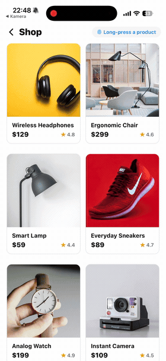

# react-native-quick-preview

[](https://www.npmjs.com/package/react-native-quick-preview)
[](https://github.com/Hashtagsmile/react-native-quick-preview/actions/workflows/ci.yml)
[](LICENSE)
[](CONTRIBUTING.md)
[](https://snack.expo.dev/@oliver.at.sellpy/react-native-quick-preview)

**The iOS long-press peek, on Android too.** Long-press an item and a preview grows out of it, with an optional context menu. It renders the same on iOS and Android, shows any React content, and works in Expo Go because there's no native code. Mount one `PreviewProvider`, then `present()` from a hook or a static handle.

**Why it exists:** the long-press peek and context menu are well served on iOS (Expo Router's `Link.Preview`, zeego, `react-native-ios-context-menu`), but those are all iOS-only, and most preview a route rather than arbitrary content. This library covers what none of them do: *a peek with a context menu that renders any React node identically on iOS **and** Android, with no native module, presentable from anywhere, no router required.* See [How it compares](packages/react-native-quick-preview/README.md#how-it-compares) for the table, including when to reach for a native library instead.

This is the development monorepo. **If you just want to use the library, read the [package README](packages/react-native-quick-preview/README.md)** for installation, quick start and the full API. It's the same document you see on [npm](https://www.npmjs.com/package/react-native-quick-preview).

<p align="center">
  
  &nbsp;
  
</p>

<p align="center"><a href="https://snack.expo.dev/@oliver.at.sellpy/react-native-quick-preview"><b>▶ Try it live in your browser (Expo Snack)</b></a> — long-press a product for a quick look, tap to open it. Best on the iOS/Android tabs.</p>

## Repository layout

```
├── packages/
│   └── react-native-quick-preview/    # The published library
│       ├── src/
│       │   ├── index.ts               # Public exports
│       │   ├── context.tsx            # PreviewProvider + controller context
│       │   ├── QuickPreviewAPI.ts     # Static QuickPreview handle
│       │   ├── useQuickPreview.ts     # Hook
│       │   ├── types.ts               # Public types
│       │   ├── headless/              # Low-level headless component
│       │   ├── internal/              # Containers, backdrop, scroll view
│       │   └── addons/                # QuickPreviewPressable
│       └── tsup.config.ts             # CJS + ESM + d.ts build
├── apps/
│   └── expo-quick-preview-example/    # Expo example app (Expo Router)
├── .github/workflows/                 # CI + release automation
└── CHANGELOG.md                       # Release history
```

## Development

Requires Node 22.13+ (React Native 0.88 tooling) and npm 10 (npm workspaces).

```bash
git clone https://github.com/Hashtagsmile/react-native-quick-preview.git
cd react-native-quick-preview
npm install

npm run build        # build the library (tsup: CJS + ESM + types)
npm run type-check   # TypeScript, no emit
npm run lint         # ESLint over the library source
npm run example      # start the Expo example app
```

The example app consumes the library through a `file:` reference, so rebuild with `npm run build` to see library changes in the example.

The example app in `apps/expo-quick-preview-example` shows the patterns the library is meant for: product previews in a grid, article teasers, travel cards. Long-press to open, swipe down to close, tap to navigate. Run it with Expo Go or a simulator (`npm run example:ios` / `npm run example:android`).

## CI and releases

CI ([ci.yml](.github/workflows/ci.yml)) runs on every push and PR to `main`: install, type check, lint, unit tests, build, and a `npm pack --dry-run` to verify what would be published.

Releases are automatic. When the package version changes on `main`, the [release workflow](.github/workflows/release.yml) re-runs all checks, publishes to npm with provenance, then tags `v<version>` and creates a GitHub Release. If the version is already on npm it does nothing, so ordinary pushes are safe. It needs an `NPM_TOKEN` repository secret (npm automation token). It can also be run manually from the Actions tab, including as a dry run.

To cut a release:

1. Bump `version` in `packages/react-native-quick-preview/package.json`
2. Add a section to [CHANGELOG.md](CHANGELOG.md)
3. Push (or merge) to `main` — the rest happens on its own

## Contributing

See [CONTRIBUTING.md](CONTRIBUTING.md). Short version: fork, branch from `main`, make sure `npm run type-check`, `npm run lint` and `npm run build` pass, and open a PR.

## License

MIT © [Oliver Lindblad](https://github.com/Hashtagsmile)
