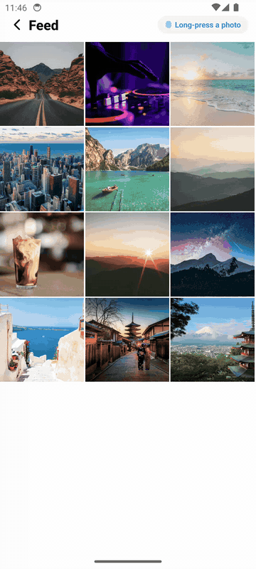
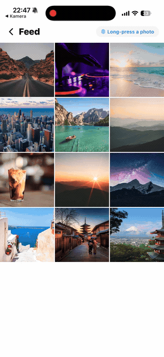
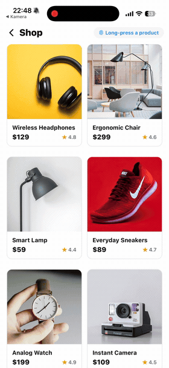

# react-native-quick-preview

[](https://www.npmjs.com/package/react-native-quick-preview)
[](https://github.com/Hashtagsmile/react-native-quick-preview/actions/workflows/ci.yml)
[](https://github.com/Hashtagsmile/react-native-quick-preview/blob/main/LICENSE)
[](https://snack.expo.dev/@oliver.at.sellpy/react-native-quick-preview)

**The iOS long-press peek, on Android too.** Long-press an item and a preview of it grows out of your finger, with a context menu underneath. It looks and behaves the same on iOS and Android, shows any React content, and works in Expo Go because it has no native code.

Expo Router's `Link.Preview`, zeego and `react-native-ios-context-menu` all stop at iOS. This library gives you the same peek and menu on both platforms, with one component.

<p align="center">
  
  &nbsp;
  
  &nbsp;
  
</p>

<p align="center"><sub>Left: Android, peek + context menu. Middle and right: feed peek and shop bottom sheet.</sub></p>

## Quick start

**1. Install** (most apps already have the three peers; React Navigation and Expo Router pull them in):

```bash
npx expo install react-native-quick-preview react-native-reanimated react-native-gesture-handler react-native-safe-area-context
```

**2. Wrap your app once:**

```tsx
import { GestureHandlerRootView } from 'react-native-gesture-handler'
import { PreviewProvider } from 'react-native-quick-preview'

export default function App() {
  return (
    <GestureHandlerRootView style={{ flex: 1 }}>
      <PreviewProvider>
        <YourApp />
      </PreviewProvider>
    </GestureHandlerRootView>
  )
}
```

**3. Wrap any list item:**

```tsx
import { QuickPreviewPressable } from 'react-native-quick-preview'

<QuickPreviewPressable
  onPress={openProduct}                                      // tap: open it
  renderPreview={() => <ProductCard product={product} />}    // long-press: peek
  onPreviewPress={openProduct}                               // tap the peek: open it
  actions={[
    { title: 'Add to cart', onPress: addToCart },
    { title: 'Share', onPress: share },
    { title: 'Remove', destructive: true, onPress: remove },
  ]}
>
  <ProductThumbnail product={product} />
</QuickPreviewPressable>
```

That's it: a long-press peek with a context menu, on iOS and Android, in Expo Go. The peek grows out of the item, shrinks back into it when closed, and closes on a tap outside, a swipe or the Android back button.

## Why use it

- **Android parity.** The peek-with-a-menu is an iOS system feature, so the native options (`Link.Preview`, zeego, `react-native-ios-context-menu`) are iOS-only. This renders the same peek and menu on both platforms.
- **Any content.** You render the preview: a product card, a post, a profile, a file. It isn't tied to a route or a native menu.
- **No native build.** Pure JS on top of Reanimated and Gesture Handler. Works in Expo Go, needs no prebuild or config plugin.
- **Callable from anywhere.** A hook, or a static `QuickPreview.present(<Card />)` that works from a store, a service or a notification handler.

| | **react-native-quick-preview** | Expo Router `Link.Preview` | zeego / ios-context-menu | @gorhom/bottom-sheet |
| --- | --- | --- | --- | --- |
| Long-press peek on **Android** | ✅ same as iOS | ❌ iOS only | ❌ iOS only (Android gets a plain menu) | ❌ no peek |
| Context-menu actions | ✅ both platforms | ✅ iOS | ✅ iOS | ❌ |
| Previews **any content** | ✅ | ❌ the linked route | ✅ | ✅ |
| Grows from / shrinks back into the item | ✅ | ✅ | ✅ | ❌ |
| Expo Go, no native build | ✅ | needs Expo Router + native stack | ❌ native module | ✅ |
| Callable outside React | ✅ `QuickPreview.present()` | ❌ | ❌ | ❌ needs a ref |
| Pixel-perfect native iOS feel | ≈ close re-creation | ✅ | ✅ | n/a |

**When not to use it:** if you're iOS-only and want the exact system look (system blur, system haptics), use `react-native-ios-context-menu`, zeego or Expo Router's `Link.Preview`. A Reanimated re-creation gets close; it isn't identical. If you only need a bottom sheet, use `@gorhom/bottom-sheet`.

## How it works

Wrap each list or grid item in `QuickPreviewPressable`:

```text
        ┌─ tap ─────────────────────────────► onPress (your detail screen)
 item ──┤
        └─ long-press ─► peek ─┬─ tap peek ──► onPreviewPress (usually the same)
                               ├─ tap action ► that action's onPress
                               └─ tap outside / swipe / back ─► closes
```

You build **one new thing per item: the preview content**, usually a compact version of a card you already have. The "full screen" is the route you already navigate to.

**Sizing the peek.** The popover is a finished card: rounded, clipped, and 92% of the screen wide (up to 520pt). Let your content fill it; don't give it a fixed `width`. To make the peek smaller, size the *card* with the `size` option instead:

```tsx
<QuickPreviewPressable previewOptions={{ size: { maxWidth: 340 } }} … />
```

For an image that should span the card, `width: '100%'` with an `aspectRatio` is enough; the card's `overflow: 'hidden'` rounds the corners for you.

### Peer dependencies

| Peer dependency | What it's for | Native? |
| --- | --- | --- |
| `react-native-reanimated` | The peek animation (worklets) | yes |
| `react-native-gesture-handler` | Long-press & swipe gestures | yes |
| `react-native-safe-area-context` | Sheet insets (its `<SafeAreaProvider>` is recommended, not required) | yes |

If Reanimated and Gesture Handler are already installed, adding this library is **JS-only, with no native rebuild**. Reanimated needs its Babel plugin; Expo sets that up via `babel-preset-expo`. Bare React Native notes are under [Requirements](#requirements).

> Upgrading from 2.0? `react-native-portalize` is no longer needed. The library ships its own overlay, so you can uninstall it.

## Requirements

- **React Native** ≥ 0.72 (peer). Tested on RN 0.88 (Expo SDK 58).
- **React** ≥ 18.2.
- **Peer dependencies** (must be installed in your app): `react-native-reanimated` (≥ 3; both Reanimated 3 and 4 are supported), `react-native-gesture-handler` (≥ 2; 2.x and 3.x are supported), `react-native-safe-area-context` (≥ 4).
- **Reanimated's Babel plugin** must be configured — this is required, not optional. React Native consumes this library's TypeScript source (the standard distribution model for Reanimated libraries), so the plugin transforms its worklets as part of your app's build. Expo configures it for you via `babel-preset-expo`; bare RN apps add it manually (`react-native-worklets/plugin` on Reanimated 4, `react-native-reanimated/plugin` on Reanimated 3). On Expo SDK 54 and later, do **not** also add the plugin by hand — `babel-preset-expo` already includes it, and a duplicate breaks worklets.
- Your app must render `<PreviewProvider>` once, inside a `<GestureHandlerRootView>` (step 2 above). With Gesture Handler 3 this is enforced: a missing `GestureHandlerRootView` throws in development instead of silently ignoring gestures.
- `<SafeAreaProvider>` (from `react-native-safe-area-context`) is **recommended** so the peek clears the notch and home indicator, but **not required** — without one the peek falls back to zero insets instead of crashing. React Navigation and Expo Router already mount it, so most apps have it.
- `expo-haptics` is **optional** — only needed if you want haptics; pass it to `QuickPreviewPressable` via `onLongPressStart`.

## Presenting from outside components

`QuickPreview` is a static handle to the same controller. Use it in event handlers, services, or anywhere React context isn't available. Before the provider mounts it's a safe no-op (with a warning in dev builds).

```tsx
import { QuickPreview } from 'react-native-quick-preview'

QuickPreview.present(<MyPreviewContent />, { variant: 'sheet' })
QuickPreview.update({ size: { maxHeight: 480 } })
QuickPreview.isOpen() // boolean
QuickPreview.close()
```

## QuickPreviewPressable

The component you'll use for almost everything. A tap runs `onPress`, a long-press opens the peek, and the item scales down slightly while pressed.

```tsx
import * as Haptics from 'expo-haptics' // optional
import { QuickPreviewPressable } from 'react-native-quick-preview'

<QuickPreviewPressable
  onPress={openProduct}
  renderPreview={() => <ProductPreview product={product} />}
  onPreviewPress={openProduct}
  actions={[{ title: 'Share', onPress: share }]}
  onLongPressStart={() => Haptics.impactAsync(Haptics.ImpactFeedbackStyle.Medium)}
  accessibilityLabel={product.name}
>
  <ProductCard product={product} />
</QuickPreviewPressable>
```

| Prop | Type | Default | Description |
| --- | --- | --- | --- |
| `renderPreview` | `() => ReactNode` | required | The peek content. Called when the long-press fires |
| `onPress` | `() => void` | | Normal tap on the item |
| `onPreviewPress` | `() => void` | | Tap on the open peek ("peek and pop"). The peek closes first, then this runs |
| `actions` | `QuickPreviewAction[]` | | Context-menu rows under the peek |
| `previewOptions` | `Partial<QuickPreviewOptions>` | | Any `present()` option, e.g. `{ variant: 'sheet' }`, `size`, `colorScheme` |
| `animateFromItem` | `boolean` | `true` | Grow the peek out of the item (popover variant) |
| `delay` | `number` | `350` | Long-press delay in ms |
| `scale` | `number` | `0.98` | Press-down scale of the item |
| `onLongPressStart` | `() => void` | | Fires right before the peek opens. Use it for haptics or analytics |
| `disabled` | `boolean` | `false` | Ignore taps, long-presses and accessibility actions |
| `style` | `StyleProp<ViewStyle>` | | Style of the wrapper (the part that scales) |
| `accessibilityLabel` | `string` | | Label of the item for screen readers |
| `accessibilityPreviewLabel` | `string` | `'Show preview'` | Name of the screen-reader action that opens the peek |

The library doesn't import `expo-haptics` itself, so you stay in control of that dependency (and Metro never has to resolve a package you don't use).

## Context-menu actions

Pass `actions` and the preview gets a menu: under the popover card, or at the bottom of the sheet. It works the same on iOS and Android, which is the "peek + menu" combination only native iOS libraries offered before. Pressing an action closes the preview, then runs it.

```tsx
<QuickPreviewPressable
  onPress={() => router.push(`/post/${post.id}`)}
  renderPreview={() => <PostPreview post={post} />}
  actions={[
    { title: 'Share', icon: <ShareIcon />, onPress: () => share(post) },
    { title: 'Copy link', onPress: () => copyLink(post) },
    { title: 'Report', destructive: true, onPress: () => report(post) },
  ]}
>
  <Thumbnail post={post} />
</QuickPreviewPressable>
```

Each action takes `title`, `onPress`, and optionally `icon` (any element, shown at the trailing edge), `destructive` (red) and `disabled`. With `present()`, pass them as `present(node, { actions })`.

## Grow from the item

`QuickPreviewPressable` measures the item you long-pressed. The popover grows out of it and, when closed, shrinks back into it, the way the native iOS peek does. It's on by default. Turn it off with `animateFromItem={false}` to get a centered fade instead.

When presenting imperatively, pass the item's rect yourself:

```tsx
ref.current?.measureInWindow((x, y, width, height) => {
  present(<Card />, { origin: { x, y, width, height } })
})
```

## Theming and dark mode

The built-in chrome (container, menu, grabber, backdrop) has a light and a dark palette. Your own content is never restyled.

```tsx
// App-wide: follow the device appearance
<PreviewProvider defaultOptions={{ colorScheme: 'system' }}>

// Per preview
present(<Card />, {
  colorScheme: 'dark',
  containerStyle: { borderRadius: 24 },
  backdropColor: 'rgba(0,0,0,0.7)',
})

// A blurred backdrop (expo-blur is your dependency, not ours)
present(<Card />, {
  renderBackdrop: () => <BlurView intensity={40} tint="dark" style={StyleSheet.absoluteFill} />,
})
```

`defaultOptions` on `PreviewProvider` sets defaults for every preview. Options passed to `present()` override them.

## Tappable preview content

To make the whole peek open the item, pass `onPreviewPress` to `QuickPreviewPressable` (see [Quick start](#quick-start)). That's all most apps need.

For buttons *inside* your preview content, use touchables from `react-native-gesture-handler`, not `react-native`. The preview renders inside a gesture-handler overlay, and React Native's own `Pressable` / `TouchableOpacity` don't reliably receive taps there.

```tsx
// ✗ tap may not fire inside the preview
import { Pressable } from 'react-native'

// ✓ works inside the preview
import { Pressable } from 'react-native-gesture-handler'

present(
  <Pressable onPress={() => { QuickPreview.close(); router.push('/detail') }}>
    <ProductPreview product={product} />
  </Pressable>,
  { variant: 'popover' }
)
```

## Scrollable previews

If the preview content scrolls, use `QuickPreviewScrollView` instead of a plain `ScrollView`. Otherwise the scroll gesture and the swipe-to-dismiss gesture fight each other.

```tsx
import { QuickPreviewScrollView } from 'react-native-quick-preview'

present(
  <QuickPreviewScrollView>
    <LongArticleContent />
  </QuickPreviewScrollView>,
  { variant: 'sheet' }
)
```

## API reference

### `present(node, options?)`

Available from `useQuickPreview()` and the static `QuickPreview`. Presents `node` as the preview content. Calling it while a preview is open replaces the content.

| Option | Type | Default | Description |
| --- | --- | --- | --- |
| `variant` | `'popover' \| 'sheet'` | `'popover'` | Centered card or bottom sheet |
| `size` | `'auto' \| number \| { maxHeight?, maxWidth? }` | `'auto'` | Constrains the preview container |
| `dismissOnBackdropPress` | `boolean` | `true` | Close when the backdrop is tapped |
| `dismissOnPanDown` | `boolean` | `true` | Close on swipe-down gesture |
| `actions` | `QuickPreviewAction[]` | | Context-menu rows shown with the preview |
| `origin` | `{ x, y, width, height }` | | Grow the popover out of this window rect (set by `QuickPreviewPressable`) |
| `colorScheme` | `'light' \| 'dark' \| 'system'` | `'light'` | Palette for the built-in container, menu and backdrop |
| `containerStyle` | `StyleProp<ViewStyle>` | | Extra style for the popover card / sheet |
| `backdropColor` | `string` | `'rgba(0,0,0,0.5)'` | Backdrop color |
| `renderBackdrop` | `() => ReactNode` | | Custom backdrop (e.g. a blur view) |
| `accessibilityLabel` | `string` | | Label announced for the preview container |
| `onOpenStart` / `onOpenEnd` | `() => void` | | Open animation lifecycle |
| `onCloseStart` / `onCloseEnd` | `() => void` | | Close animation lifecycle |

### Controller

Both `useQuickPreview()` and the static `QuickPreview` expose:

| Method | Description |
| --- | --- |
| `present(node, options?)` | Open a preview with the given content |
| `close()` | Dismiss the current preview |
| `update(options)` | Merge new options into the open preview |
| `isOpen()` | Whether a preview is currently open |

### Exports

| Export | Purpose |
| --- | --- |
| `PreviewProvider` | Hosts the preview layer; mount once at the root. Optional `defaultOptions` prop |
| `useQuickPreview` | Controller from React context (throws outside the provider) |
| `QuickPreview` | Static controller handle (safe no-op before mount) |
| `QuickPreviewPressable` | Long-press-to-preview wrapper with tap-through |
| `QuickPreviewScrollView` | Gesture-aware ScrollView for preview content |
| `QuickPreviewComponent` | Low-level headless component, for fully custom hosts |
| `QuickPreviewOptions`, `QuickPreviewVariant`, `QuickPreviewSize`, `QuickPreviewController`, `QuickPreviewAction`, `QuickPreviewColorScheme`, `QuickPreviewOrigin` | Public TypeScript types |

## Accessibility

A long-press is hard to perform with VoiceOver or TalkBack, so `QuickPreviewPressable` exposes the peek as an accessibility action. Screen-reader users get **"Show preview"** (rename it with `accessibilityPreviewLabel`) next to the normal activate action, which runs `onPress`.

Also:
- Open and close are announced via `AccessibilityInfo.announceForAccessibility`.
- While open, the preview is `accessibilityViewIsModal`, so focus stays inside it.
- The backdrop is an accessible "Close preview" button, and the Android back button closes the preview.
- Action rows are `menuitem`s with their titles as labels, and disabled rows report it.
- `accessibilityLabel` on the container is forwarded to assistive tech.

## Example app

The [repo](https://github.com/Hashtagsmile/react-native-quick-preview) contains an Expo example app with e-commerce, article and travel preview patterns:

```bash
git clone https://github.com/Hashtagsmile/react-native-quick-preview.git
cd react-native-quick-preview
npm install
npm run build
npm run example
```

The example app is on **Expo SDK 58** (React Native 0.88, Reanimated 4.7, Gesture Handler 3) and runs in Expo Go on iOS and Android. See its [recording guide](https://github.com/Hashtagsmile/react-native-quick-preview/blob/main/apps/expo-quick-preview-example/RECORDING.md) if you want to reproduce the demo GIFs.

## Compatibility

| | Status |
| --- | --- |
| **Platforms** | iOS and Android (identical rendering — it's pure JS/Reanimated) |
| **Expo** | Works in Expo Go and dev clients. No config plugin, no prebuild, no native module. |
| **Bare React Native** | Supported (configure the Reanimated Babel plugin yourself). |
| **New Architecture** | Supported. Tested on RN 0.88 + Reanimated 4.7 + Gesture Handler 3 (Expo SDK 58), and RN 0.81 + Reanimated 4 (Expo SDK 54). |
| **Old Architecture** | Supported via Reanimated 3. |
| **Web (react-native-web)** | Not a target. It may partially work, but gestures and the overlay aren't tested there. |

## Limitations

Be clear-eyed about what this is and isn't:

- **It's a re-creation, not the native OS peek.** On iOS, `react-native-ios-context-menu` and Expo Router's `Link.Preview` use the system `UIContextMenuInteraction` (system blur, morph, tuned haptics). This library re-creates that feel (grow-from-item, menu) with Reanimated. It's close, not pixel-identical. If you're iOS-only and want native fidelity, use one of those instead (see [Why use it](#why-use-it)).
- **The menu is one level.** Actions are flat rows; there are no submenus, and you can't slide your finger onto an action without lifting it as you can in the native menu.
- **Haptics aren't automatic.** Native context menus fire system haptics for free; here you wire them via `onLongPressStart` (one line — see `QuickPreviewPressable`).
- **One preview at a time.** Calling `present()` while a preview is open replaces the content; previews don't stack.
- **Light theme by default.** Opt into `colorScheme: 'system'` (or `'dark'`). The default stays light so upgrading from 2.0 doesn't change your app's look.
- **Screen-reader announcements are English** ("Quick preview opened/closed"). Labels you pass are used verbatim, but the built-in announcement strings aren't localized yet.
- **Requires the peer setup.** Without `GestureHandlerRootView` + `PreviewProvider`, or with a missing Reanimated Babel plugin, it won't work. Expo apps get the Babel plugin automatically.
- **The headless `QuickPreviewComponent` closes instantly.** It unmounts as soon as `visible` turns false, so it has no exit animation. The provider-based API (`QuickPreviewPressable`, `present()`) animates out.

## Versioning

This package follows semver. Release notes live in the [CHANGELOG](https://github.com/Hashtagsmile/react-native-quick-preview/blob/main/CHANGELOG.md).

Heads up if you're coming from 1.x: version 2.0.0 replaced the old `<QuickPreview visible onClose>` component with the provider + controller architecture described above. v1 code will not compile against v2. The changelog has migration notes.

## License

MIT © Oliver Lindblad
